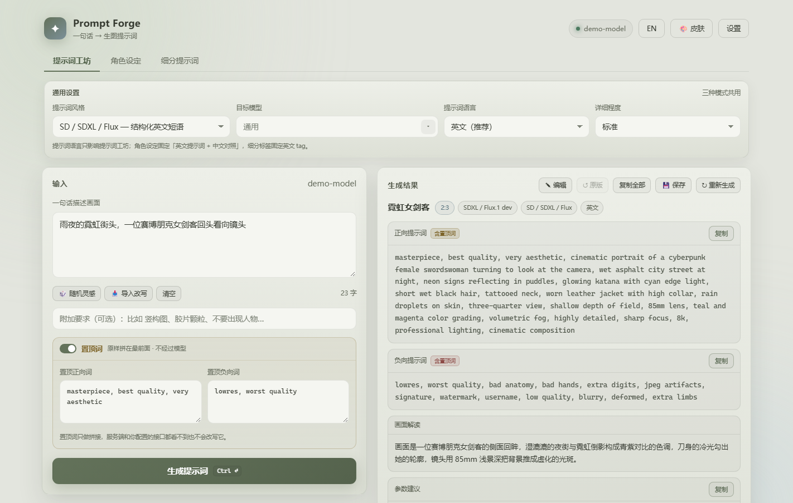
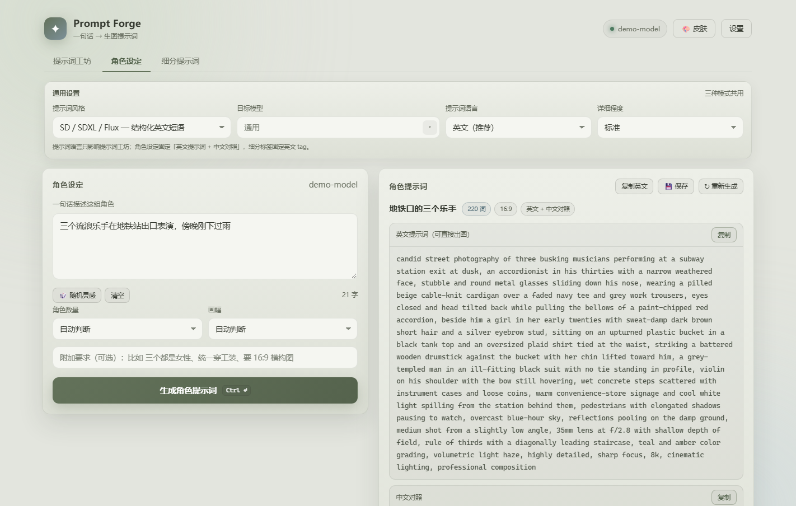
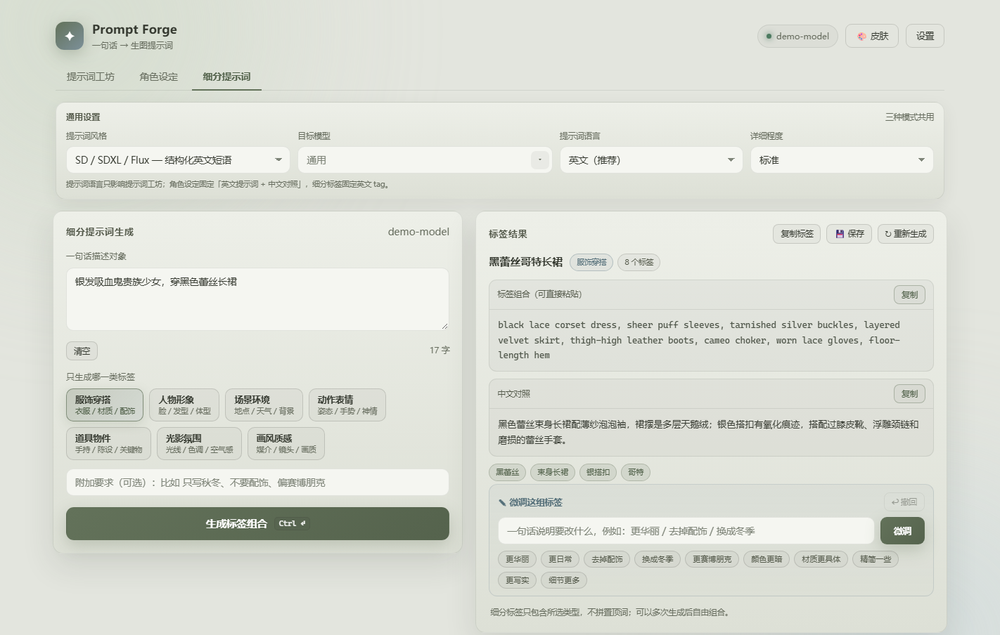

# Prompt Forge

[](https://github.com/yu20000505/prompt-forge/actions/workflows/ci.yml)
[](LICENSE)

**One sentence in. A production-ready image prompt out.**

Prompt Forge is a local-first desktop tool that turns a single plain-language sentence into
prompts you can paste straight into Stable Diffusion, NovelAI, Midjourney, Flux or DALL·E.
It also builds character sheets with an English prompt and a Chinese translation, plus seven
segment-tag groups (outfit, character look, scene, pose, props, lighting, style) you can combine
freely. Every result can be refined with one sentence, undone, and saved to a local library.

No accounts, no telemetry, no cloud sync. It talks directly to whatever
**OpenAI-compatible API** you configure, and your key never leaves your machine.

[中文说明](README.md) · [Download](../../releases) · [Build from source](#build-from-source)



---

## Why

Writing image prompts by hand is repetitive: you know what you want, but translating a mental
image into `masterpiece, best quality, cinematic lighting, 85mm, f/1.4 …` is the slow part.
Prompt Forge does the translation, then lets you iterate with short natural-language edits
instead of hand-splicing tags.

## Features

- **Five prompt dialects** — SD/SDXL/Flux structured phrases, NovelAI danbooru tags,
  Midjourney (parameters placed in `--ar`/`--style`), photorealistic photography, and plain
  natural language.
- **Character sheet mode** — describes who is in frame, what they wear, the scene, the action and
  the camera, then outputs one flowing English prompt plus a Chinese translation.
- **Segment tags** — generate one dimension at a time (outfit, character look, scene, pose,
  props, lighting, style) as a comma-separated English tag set; refine it with one sentence,
  undo, copy, save or splice several sets into a full prompt.
- **Assembly board** — collect tag sets over time (one per dimension), splice them into a single
  paste-ready tag string in a fixed order, dedupe automatically, then copy or save to the library.
  It survives reloads and restarts.
- **Refine instead of regenerate** — after generating, say `make it night` / `remove the person` /
  `vertical composition`; only what you mention changes, everything else stays verbatim.
  Unlimited undo.
- **Hand editing** — fix the positive/negative prompt, interpretation, parameters, character text or
  segment tags directly; edited results are marked, flow into copy/save/history, and can be reverted
  to the model original in one click.
- **Two independent pinning layers**
  - *Local prefix* — fixed quality tags prepended in the browser. Never sent to the model.
  - *API preamble* — your own standing instructions injected into the system prompt for prompt
    generation, refinement, character sheets and segment tags. Idea requests skip it by default
    to save tokens; you can opt in from Settings.
- **Idea generator** — asks the model for six fresh scene one-liners, avoiding topics you just used.
- **History** — prompt, character and segment results are recorded automatically; filter by mode,
  search, favorite to pin on top, and click an entry to restore the full result.
- **Local library** — save any result as a readable Markdown file, grouped into collapsible prompt,
  character and segment sections; browse, search, rename, reload or delete. Deletions go to
  `saved/.trash` and can be undone for 8 seconds; the trash is purged after 7 days.
- **Seven Morandi skins** — six low-saturation light palettes plus one dark theme, all
  WCAG contrast checked.
- **Zero runtime dependencies** — the server uses only Node built-ins.





## Quick start

### Option A — use a release build

| Build | Size | Behavior |
| --- | --- | --- |
| `PromptForge-Desktop.exe` | ~105 MB | Real desktop window (Electron). No browser, no console. |
| `PromptForge.exe` | ~88 MB | Starts a local server and opens your browser. |

Both are self-contained — no Node.js required on the target machine.
Grab them from [Releases](../../releases).

> Windows may warn about an unknown publisher; the binaries are not code-signed.
> Click *More info → Run anyway*.

### Option B — run from source

```bash
git clone https://github.com/yu20000505/prompt-forge.git
cd prompt-forge
node src/server.mjs          # on Windows you can also double-click 启动.bat
```

Requires Node.js 20+. Nothing to install — there is no `npm install` step for runtime.

> After editing `src/server.mjs` / `src/styles.mjs`, restart the server; refreshing the browser
> does not reload backend code. If the UI says the server is stale, stop the console and rerun it.

Open <http://127.0.0.1:43125>, click **设置** (Settings) and fill in:

| Field | Example |
| --- | --- |
| Base URL | `https://api.deepseek.com` (a bare domain gets `/v1` appended) |
| API Key | `sk-…` |
| Model | `deepseek-chat` |

Any OpenAI-compatible endpoint works — DeepSeek, OpenAI, Moonshot, Zhipu, SiliconFlow,
LM Studio, Ollama, or a proxy. Hit **测试连接** to verify, then **保存**.

## Build from source

Runtime has no dependencies; the packaging steps pull their own toolchain on first run.

```bash
npm run build:exe       # → release/PromptForge.exe                 (Node SEA, single file)
npm run build:desktop   # → release-desktop/PromptForge-Desktop.exe  (Electron desktop app)
```

How `build:exe` works: `esbuild` bundles the ESM server into one CommonJS file (Node SEA only
accepts a CJS entry) → `node --experimental-sea-config` embeds the bundle plus the three frontend
assets into a blob → a copy of `node.exe` is used as the base → `postject` injects the blob and
flips the SEA fuse.

`build:desktop` bundles the same server, copies the frontend, and ships an Electron main process
that boots the server in-process and opens a native window.

### Code signing (optional)

Release binaries are unsigned by default, so Windows may show an unknown-publisher warning.
With your own Authenticode certificate:

```powershell
npm run build:all
$env:PF_SIGN_PFX = 'C:\certs\prompt-forge.pfx'
$env:PF_SIGN_PASSWORD = '...'
npm run sign
```

In CI, set the `WINDOWS_PFX_BASE64` and `WINDOWS_PFX_PASSWORD` repository secrets and `v*` tags
will be signed automatically; without them the step is skipped. See
[docs/SIGNING.md](docs/SIGNING.md) for timestamp servers, hardware tokens and verification.
Self-signed certificates do not remove the warning.

## Tests

```bash
npm run test:static    # id references, prompt templates, theme contrast — no browser needed
npm test               # full UI regression: 361 assertions in headless Chrome
```

The UI suite boots a throwaway server against a mock OpenAI endpoint and asserts real behavior:
contrast of every text node across all skins, layout geometry, streaming, refine/undo, the save
library round-trip (including on-disk file contents), and the absence of console errors.

```
PASS  默认皮肤是莫兰迪浅色 (default skin is the light Morandi palette)
PASS  输入区在结果区左侧（左右分栏） (input sits left of results)
PASS  微调结果仍带置顶词（只带一次） (pinned prefix not duplicated after refine)
PASS  保存的是带置顶词的实际版本 (saved file matches what you see)
PASS  载入时置顶词没有被二次拼接 (no double-prefixing when reloading)
...
361 passed, 0 failed
```

Screenshots in `docs/` are generated by `node tests/make-screenshots.mjs`, not hand-cropped.

## Project layout

```
src/
  server.mjs         HTTP server + OpenAI-compatible proxy (SSE), config & library I/O
  styles.mjs         system-prompt templates for all modes
  public/            index.html, styles.css (theme tokens), app.js
build/
  build-exe.mjs      Node SEA packaging
  build-desktop.mjs  Electron packaging
  electron/          Electron main process + builder config
tests/               regression suite, mock API, static checkers, screenshot generator
docs/screenshots/    images used by these READMEs
```

## Privacy

- Your API key is stored in `config.json` **in plain text, on your machine only**.
- The UI never receives the key back — settings show a masked hint (`sk-…abcd`).
- Prompts and results are only sent to the endpoint you configure.
- Saved prompts are ordinary `.md` files in `saved/`.

Windows builds keep data in `%APPDATA%\PromptForge`; running from source keeps it next to the app.

## License

[MIT](LICENSE)
