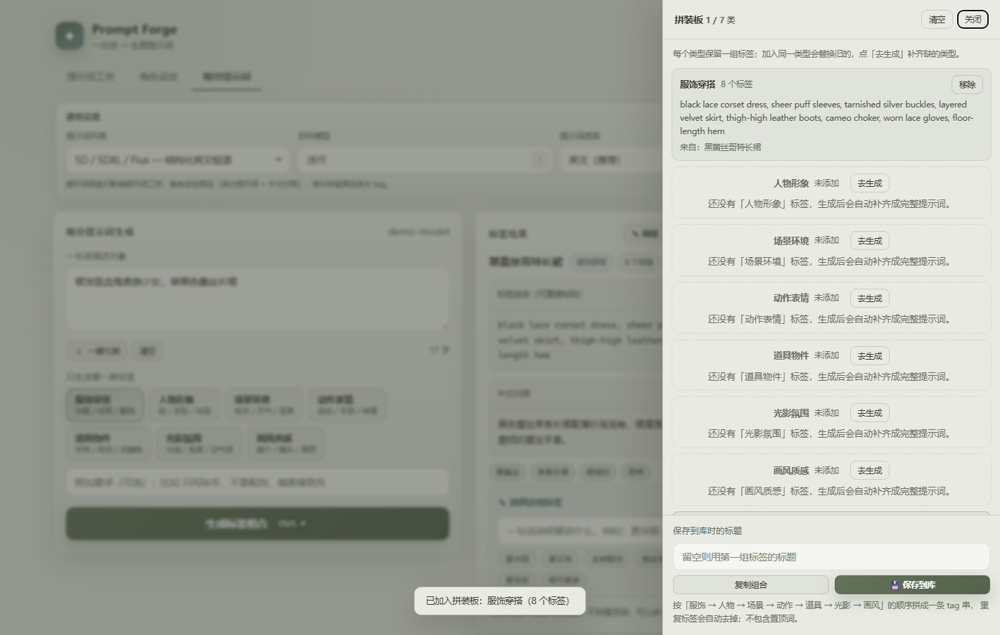

# Prompt Forge

[](https://github.com/yu20000505/prompt-forge/actions/workflows/ci.yml)
[](../../releases)
[](LICENSE)

**一句话进，可出图的提示词出来。2.1**

Prompt Forge 是一个纯本地的小工具：写一句中文，它帮你调大模型生成
Stable Diffusion / NovelAI / Midjourney / Flux / DALL·E 能直接用的提示词；
还能产出「英文提示词 + 中文对照」的角色设定，以及服饰、人物、场景等七类可自由拼装的细分 tag。

2.0 把「生成之后」的流程补完整了：结果可以直接手改，提示词 / 角色 / 细分统一进历史，
七类标签一键生成并拼进拼装板，保存库支持全文检索、收藏和备份，接口失败会自动重试，界面中英双语。
2.1 继续补上多方案对比、模板与画幅、草稿恢复、回收站、多服务商档案和桌面窗口细节。
全程不需要注册、不上传数据，直连你自己配置的 **OpenAI 兼容接口**，Key 只存在本机。

[English](README.en.md) · [下载](../../releases) · [更新日志](CHANGELOG.md) · [自己构建](#自己构建)


## 2.1 新功能

- **多方案生成** —— 一句话一次出 3 个候选，并排比较后选一个继续微调或保存。
- **版本时间线** —— 提示词 / 角色 / 细分都可点选历史版本；提示词支持与上一版差异高亮，复制可选正向、负向、JSON、Midjourney 参数。
- **模板与预设** —— 10 个内置题材模板、3 组负面词预设、画幅/镜头快捷，当前输入可存成自定义模板。
- **草稿自动保存** —— 三个模式的输入和当前结果自动保存在本机，刷新或崩溃后可恢复，可一键清空。
- **回收站** —— 浏览、恢复、彻底删除，显示剩余保留天数。
- **多服务商档案** —— 保存多套 BaseURL / Key / 模型并一键切换；桌面版尝试系统凭据加密，诊断导出不含明文 Key。
- **桌面版细节** —— 单实例锁、第二次启动聚焦已有窗口、记忆窗口大小和位置。

## 2.0 基础功能

- **结果可手改** —— 正向、负向、画面解读、参数，角色英文/中文，细分标签都能直接编辑；标记「已手改」，也可一键恢复模型原版。
- **导入改写** —— 粘贴网上找到的现成提示词，按当前风格重写，补负面词、中文解读和参数。
- **统一历史** —— 三种模式都自动记录，可按类型筛选、搜索、收藏置顶，点一条恢复完整结果。
- **七类一键生成 + 拼装板** —— 一次跑完七类标签，自动去重拼成一条可直接粘贴的 tag 串。
- **保存库升级** —— 全文检索、高亮、收藏、排序、批量删除，以及不含 Key 的 JSON 备份/导入。
- **更稳的接口** —— 429/5xx/网络失败自动退避重试；max_tokens、超时、top_p、流式、JSON 模式可调，截断会提示。
- **中英双语** —— 右上角一键切换中文 / English。

---

## 它解决什么问题

想要的画面在脑子里很清楚，但要翻译成
`masterpiece, best quality, cinematic lighting, 85mm, f/1.4 …` 很费劲。
Prompt Forge 负责翻译，然后让你用一句人话继续微调，而不是手工拼接标签。

## 功能

- **五种提示词风格** —— SD/SDXL/Flux 结构化短语、NovelAI 的 danbooru 标签流、
  Midjourney（参数自动放进 `--ar` / `--style`）、写实摄影、自然语言直述。
- **角色设定模式** —— 把画面里有谁、穿什么、在什么场景、做什么动作、什么镜头写清楚，
  直接输出一整段可出图的英文提示词 + 中文对照。
- **细分提示词生成** —— 把服饰、人物形象、场景、动作表情、道具、光影、画风拆成七类，
  每次只生成其中一类的英文 tag 组合；可微调、撤回，也能复制、保存、载入后自由拼装。
- **拼装板** —— 把不同时间生成的七类标签攒进一块板子（每个类型保留最新一组），
  按固定顺序拼成一条可直接粘贴的 tag 串，重复标签自动去掉；
  可以一键复制或存进保存库，刷新页面、重启程序都还在。
- **一键七类** —— 细分页可以一次跑完七类标签，显示当前进度和已用时间，可中途取消，
  完成的类型自动进拼装板；没跑完的可以「补齐剩余」。
- **接口失败自动重试** —— 429、5xx、超时和网络抖动会自动退避重试，界面上显示重试状态；
  Key 无效、地址或模型名不对这类错误不会白重试，直接给出对应提示。
- **请求参数可调** —— 可设置最大输出 tokens、空闲超时、top_p、流式开关和 JSON 模式；
  输出被截断时会明确提示，思考模型的推理阶段会显示「思考中」。
- **导入已有提示词改写** —— 粘贴一段现成提示词（中英混杂也行），保留主体和画面意图，
  按当前风格重写，补负面词、中文解读和参数建议，之后照常微调、保存、进历史。
- **多方案生成** —— 一句话一次出 3 个候选，并排比较后选一个继续微调或保存。
- **模板与预设** —— 10 个内置题材模板、3 组负面词预设、画幅/镜头快捷；
  当前输入可以存成自定义模板。
- **草稿自动保存** —— 三个模式的输入和当前结果自动保存在本机，刷新或崩溃后可恢复，可一键清空。
- **多服务商档案** —— 保存多套 BaseURL / Key / 模型并一键切换；桌面版会尝试系统凭据加密，
  诊断导出不含明文 Key。
- **回收站管理** —— 浏览、恢复、彻底删除，显示剩余保留天数。
- **微调而不是重新生成** —— 生成后说「改成夜景」「去掉人物」「竖构图」，
  只改你提到的地方，其余逐字保留，可无限撤回。
- **结果可手改** —— 生成后能直接修正向、负向、画面解读、参数，角色和细分标签也能改；
  改完标记「已手改」，复制、保存、历史都用修改后的版本，也能一键恢复模型原版。
- **两层互不干扰的「置顶」**
  - 本地置顶词：只在浏览器里拼到输出前面，**永远不会发给模型**；
  - 置顶提示词：你写的一段长期要求，生成 / 微调 / 角色设定 / 细分标签时都会注入系统提示词；
    随机灵感默认不注入（省 token），需要的话在设置里打开。
- **随机灵感** —— 让模型现编 6 条场景句，自动避开你刚用过的题材。
- **历史记录** —— 提示词、角色设定、细分标签都会自动记下；可按类型筛选、搜索、
  收藏置顶，点一条就恢复当时的完整结果；历史和拼装板会落到本地数据目录，
  换浏览器或清缓存也不会丢。
- **本地保存库** —— 结果可存成可读的 `.md` 文件，按提示词 / 角色设定 / 细分提示词三类分组，
  点分类标题可收起 / 展开；支持全文检索、关键词高亮、收藏置顶、按时间/标题排序、
  批量选择删除、改名、重新载入；删除先进 `saved/.trash` 回收站，可撤销，7 天后自动清理。
- **备份与导入** —— 一键导出 JSON 备份（保存库文件、历史、拼装板、脱敏设置，不含 API Key）；
  导入时可选择合并（重名自动加后缀）或覆盖（旧文件先移入回收站）。
- **中英双语界面** —— 右上角一键切换中文 / English，语言选择会记住；
  界面文案、按钮、设置、保存库、历史、导入/备份弹窗和常见错误提示都有英文版本。
- **键盘与无障碍** —— 保存库/历史可用 Tab + Enter 操作，抽屉有焦点陷阱，
  `?` 打开快捷键帮助，流式状态会被屏幕阅读器播报。
- **七套莫兰迪皮肤** —— 六套低饱和浅色 + 一套深色，配色都经过 WCAG 对比度校验。
- **运行时零依赖** —— 服务端只用 Node 内置模块，不需要 `npm install`。




## 快速开始

### 方式一：用打包好的 exe

| 版本 | 体积 | 行为 |
| --- | --- | --- |
| `PromptForge-Desktop.exe` | ~105 MB | 真正的桌面窗口（Electron），不开浏览器、没有命令行窗口 |
| `PromptForge.exe` | ~84 MB | 起本地服务并打开浏览器 |

两者都自带运行时，**目标电脑不需要装 Node**。到 [Releases](../../releases) 下载。
发布包会附带 `SHA256SUMS.txt`，可以用 `Get-FileHash` 或 `sha256sum` 校验。

> exe 未做代码签名，Windows 可能提示「未知发布者」，点「更多信息 → 仍要运行」即可。

### 方式二：直接跑源码

```bash
git clone https://github.com/yu20000505/prompt-forge.git
cd prompt-forge
node src/server.mjs          # Windows 也可以双击 启动.bat
```

需要 Node.js 20+，运行时不需要装任何依赖。

> 改了 `src/server.mjs` / `src/styles.mjs` 之后要重启服务；只刷新浏览器不会替换后端代码。
> 如果界面提示「服务端还是旧进程」，关掉命令行窗口重新运行即可。

打开 <http://127.0.0.1:43125>，点右上角「设置」填三样：

| 项目 | 例子 |
| --- | --- |
| BaseURL | `https://api.deepseek.com`（只写域名会自动补 `/v1`） |
| API Key | `sk-…` |
| 模型名 | `deepseek-chat` |

任何 OpenAI 兼容服务都能用：DeepSeek、OpenAI、Kimi、智谱、硅基流动、LM Studio、Ollama、中转站。
填完点「测试连接」确认，再「保存」。

## 自己构建

运行时没有依赖，但打包工具链会在首次运行时自动安装。

```bash
npm run build:exe       # → release/PromptForge.exe            （Node SEA 单文件）
npm run build:desktop   # → release-desktop/PromptForge-Desktop.exe （Electron 桌面版）
```

- `build:exe` 的原理：`esbuild` 把 ESM 服务端打成单个 CJS（SEA 入口只接受 CJS）→
  `node --experimental-sea-config` 把 bundle 和三个前端文件一起塞进 blob →
  以本机 `node.exe` 为底座 → `postject` 注入 blob 并打开 SEA fuse。
- `build:desktop`：除上面的服务端 bundle 外，还会打一个 Electron 主进程，
  在进程内起服务并开原生窗口。

### 代码签名（可选）

发布产物默认未签名，Windows 可能提示「未知发布者」。有自己的 Authenticode 证书时：

```powershell
npm run build:all
$env:PF_SIGN_PFX = 'C:\certs\prompt-forge.pfx'
$env:PF_SIGN_PASSWORD = '...'
npm run sign
```

CI 里配置 `WINDOWS_PFX_BASE64` 和 `WINDOWS_PFX_PASSWORD` 两个 Secret，打 `v*` 标签时会自动签名；
未配置则跳过。详细步骤、时间戳和硬件令牌用法见 [docs/SIGNING.md](docs/SIGNING.md)。
自签名证书不能消除提示。

## 测试

```bash
npm run test:static    # id 引用、prompt 模板、主题对比度，不需要浏览器
npm run test:server    # 服务端纯函数单测（地址归一化、元数据、灵感解析等）
npm test               # 完整 UI 回归：无头 Chrome 里跑 491 条断言
```

UI 套件会用假接口起一个临时实例，验证真实行为：全部皮肤下每个文字节点的对比度、
布局几何、流式输出、微调与撤回、保存库的写入与回读（连磁盘文件内容一起验）、
历史/拼装板服务端落盘、键盘焦点与快捷键、控制台是否报错。
CI 会在 Linux 上跑完整 UI 回归，并在 Windows 上打包 exe 做启动冒烟。

```
PASS  默认皮肤是莫兰迪浅色
PASS  输入区在结果区左侧（左右分栏）
PASS  微调结果仍带置顶词（只带一次）
PASS  保存的是带置顶词的实际版本
PASS  载入时置顶词没有被二次拼接
...
491 项通过，0 失败
```

`docs/` 里的截图由 `node tests/make-screenshots.mjs` 生成，不是手工裁剪。

## 目录结构

```
src/
  server.mjs         HTTP 服务 + OpenAI 兼容代理（SSE 流式），配置与保存库读写
  styles.mjs         各模式的 system prompt 模板
  public/            index.html、styles.css（主题 token）、i18n.js（中英文案）、app.js
build/
  build-exe.mjs      SEA 打包
  build-desktop.mjs  Electron 打包
  electron/          主进程与打包配置
tests/               回归套件、假接口、静态检查、截图生成
docs/screenshots/    README 用图
```

## 隐私

- API Key 明文存在本机 `config.json`，**只在你自己的电脑上**；
- 界面永远拿不到 Key 原文，设置里只显示掩码（`sk-…abcd`）；
- 提示词和结果只会发给你配置的那个接口；
- 保存的提示词就是 `saved/` 下的普通 `.md` 文件。

Windows 打包版把数据放在 `%APPDATA%\PromptForge`，源码版放在程序目录。

## 协议

[MIT](LICENSE)
